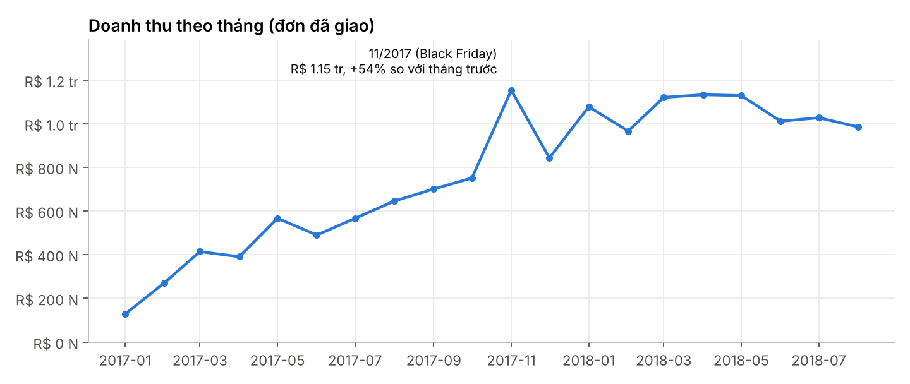
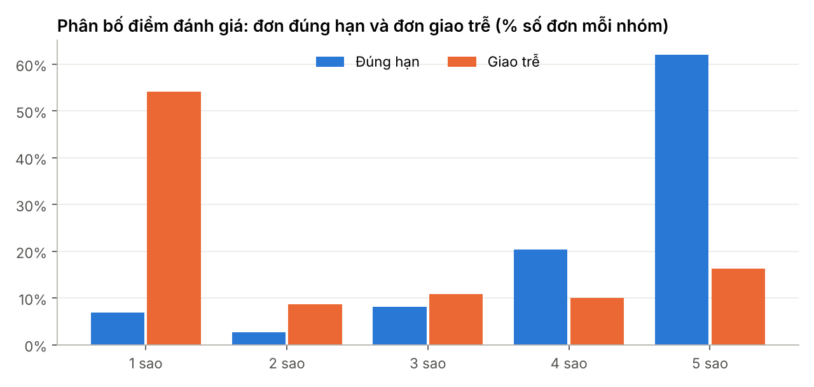
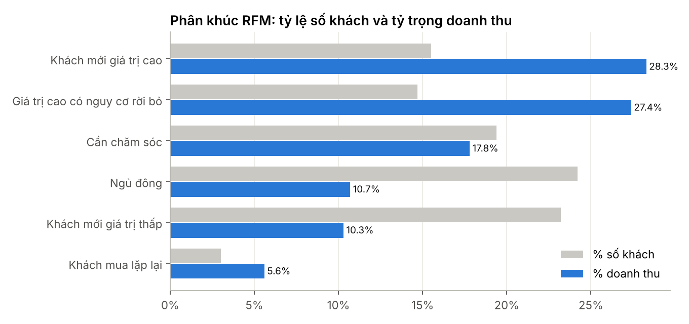
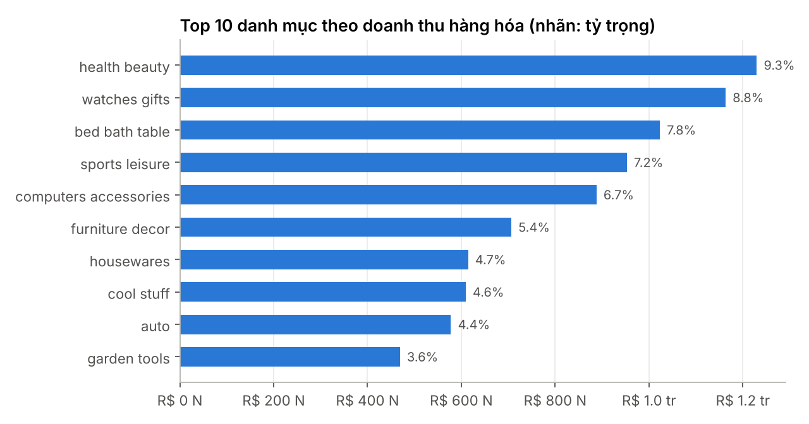

# Phân tích doanh số và phân khúc khách hàng thương mại điện tử (Olist)

Phân tích dữ liệu đơn hàng của sàn thương mại điện tử Olist (Brazil) để trả lời ba câu hỏi kinh doanh:

1. Doanh thu biến động thế nào theo thời gian và tập trung ở danh mục nào?
2. Giao hàng trễ ảnh hưởng ra sao đến mức độ hài lòng của khách?
3. Khách hàng chia thành những nhóm nào theo hành vi mua (RFM), nhóm nào cần ưu tiên?

**Công cụ:** SQL (SQLite) · Python (pandas, matplotlib) · Power BI (DAX)
**Dữ liệu:** [Brazilian E-Commerce Public Dataset by Olist](https://www.kaggle.com/datasets/olistbr/brazilian-ecommerce) – 8 bảng liên kết, 99.441 đơn hàng (09/2016 – 10/2018).
**Phạm vi phân tích:** 01/2017 – 08/2018 (bỏ các tháng đầu/cuối có quá ít đơn), chỉ tính đơn đã giao. Đơn vị tiền: BRL (R$).

## Kết quả chính

| Chỉ số | Giá trị |
|---|---|
| Đơn đã giao | 96.203 |
| Khách hàng | 93.096 |
| Doanh thu (giá hàng + phí vận chuyển) | R$ 15,37 triệu |
| Giá trị đơn trung bình | R$ 159,78 |

- **97,0% khách chỉ mua một lần.** Chỉ 3,0% khách quay lại mua, đóng góp 5,6% doanh thu → tỷ lệ giữ chân khách rất thấp.
- **Giao trễ kéo điểm đánh giá từ 4,28 xuống 2,26** (thang 5). 6,8% đơn giao trễ so với ngày dự kiến; trong nhóm này 62,9% đánh giá 1–2 sao, so với 9,5% ở nhóm giao đúng hạn.
- **Hai nhóm khách giá trị cao chiếm 30,2% số khách nhưng tạo ra 55,7% doanh thu.** Một nửa trong số đó (14,7% số khách, 27,4% doanh thu) đã không mua trung bình 392 ngày (khoảng 13 tháng) → nhóm nên ưu tiên tái kích hoạt.
- **Doanh thu tập trung:** 18/74 danh mục tạo ra 80% doanh thu hàng hóa; top 3 (health beauty, watches gifts, bed bath table) chiếm 25,9%.
- **Mùa vụ:** tháng 11/2017 (Black Friday) đạt đỉnh R$ 1,15 triệu, tăng 53,5% so với tháng trước.






## Đề xuất

1. Gửi ưu đãi cho đơn thứ hai trong 30–60 ngày sau lần mua đầu để tăng tỷ lệ quay lại.
2. Theo dõi tỷ lệ giao trễ theo bang/người bán như một KPI vận hành; chủ động thông báo và bồi thường khi đơn có nguy cơ trễ.
3. Chạy chiến dịch tái kích hoạt riêng cho nhóm "Giá trị cao có nguy cơ rời bỏ".

## Quy trình

| Bước | Công cụ | Nội dung | File |
|---|---|---|---|
| 1. Làm sạch | Python (pandas) | Chuyển kiểu ngày; gắn cờ 2.965 đơn thiếu ngày giao; giữ đánh giá mới nhất cho 559 đơn có nhiều đánh giá; gán `unknown` cho 610 sản phẩm thiếu danh mục; dịch 2 danh mục chưa có bản dịch; loại 9 thanh toán ≤ 0 | `src/01_clean_load.py`, `outputs/tables/data_quality_log.csv` |
| 2. Truy vấn | SQL (SQLite) | JOIN 5 bảng, hàm tổng hợp, window function (`LAG`, `SUM OVER`, `RANK`, `NTILE`) cho doanh thu theo tháng, Pareto danh mục, giao hàng – đánh giá, chấm điểm RFM | `sql/*.sql`, `src/02_run_sql.py` |
| 3. Phân tích & trực quan | Python (matplotlib) | Biểu đồ và nhận định | `notebooks/analysis.ipynb` |
| 4. Dashboard | Power BI (DAX) | Mô hình dạng sao, measure DAX, 3 trang dashboard | `powerbi/` |

### Phân khúc RFM

R và M chấm điểm 1–5 bằng `NTILE(5)`; F chấm theo số đơn (1 đơn = 1 điểm, 2 đơn = 4, từ 3 đơn = 5) vì 97% khách chỉ có một đơn.

| Phân khúc | Quy tắc |
|---|---|
| Khách mua lặp lại | Từ 2 đơn trở lên |
| Khách mới giá trị cao | R ≥ 4 và M ≥ 4 |
| Khách mới giá trị thấp | R ≥ 4 và M < 4 |
| Giá trị cao có nguy cơ rời bỏ | R ≤ 2 và M ≥ 4 |
| Ngủ đông | R ≤ 2 và M < 4 |
| Cần chăm sóc | Còn lại (R = 3) |

## Chạy lại

```bash
pip install -r requirements.txt
bash scripts/get_data.sh          # tải 8 file CSV vào data/raw/
python src/01_clean_load.py       # làm sạch + nạp SQLite
python src/02_run_sql.py          # chạy truy vấn SQL
python src/03_export_powerbi.py   # xuất dữ liệu cho Power BI
jupyter notebook notebooks/analysis.ipynb
```

## Cấu trúc thư mục

```
├── data/raw/            # dữ liệu gốc (không đưa lên Git, tải bằng scripts/get_data.sh)
├── sql/                 # truy vấn phân tích
├── src/                 # làm sạch, chạy SQL, xuất dữ liệu Power BI
├── notebooks/           # phân tích và biểu đồ
├── outputs/             # bảng kết quả và hình
└── powerbi/             # dữ liệu mô hình, measure DAX, hướng dẫn dashboard
```

---
Tác giả: **Nguyễn Duy Hiếu** – sinh viên Khoa học dữ liệu, UNETI · [LinkedIn](https://www.linkedin.com/in/dungggxg9425) · [GitHub](https://github.com/dungggxg9425)
